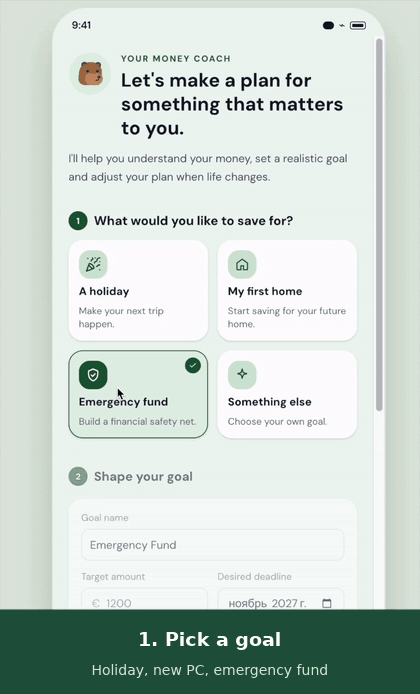
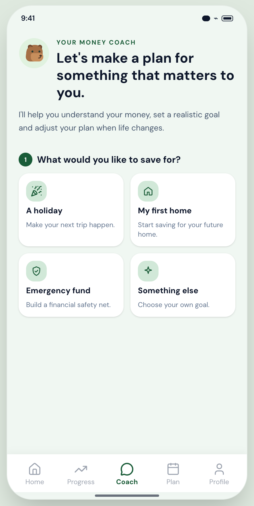
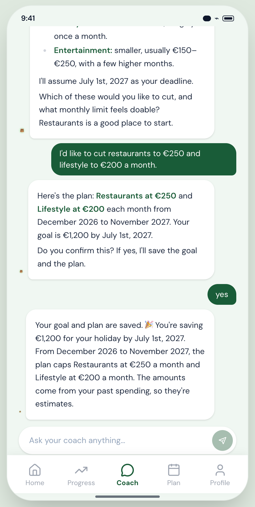
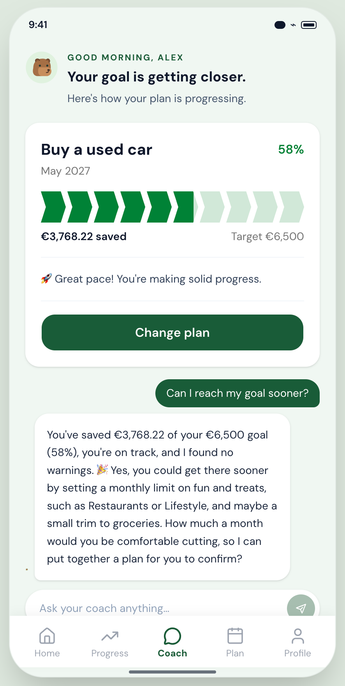
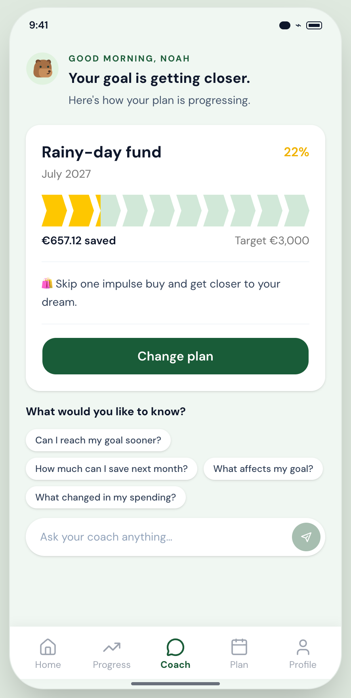
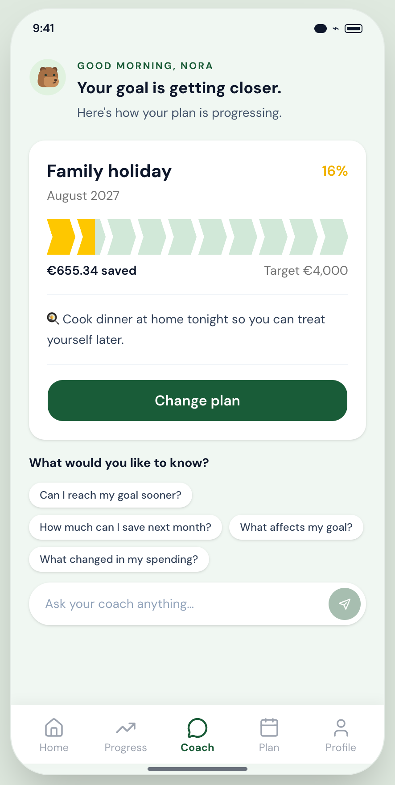
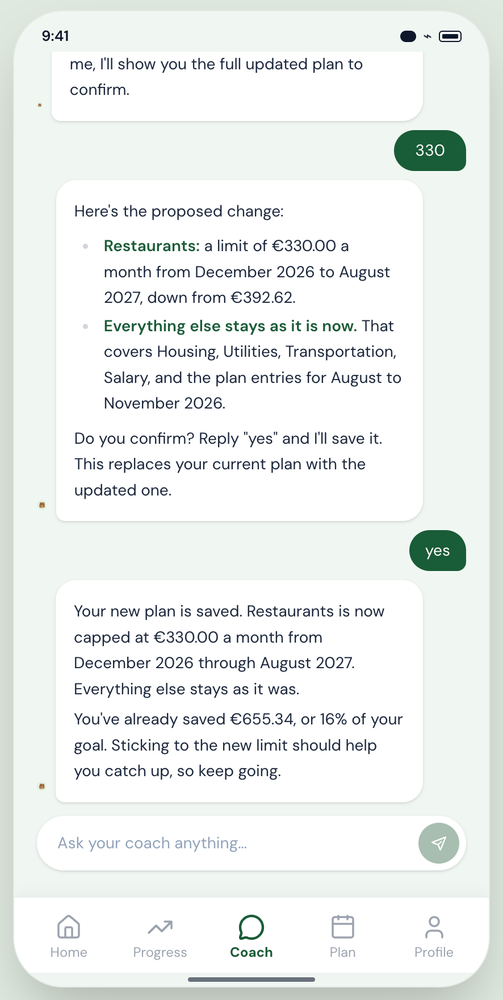
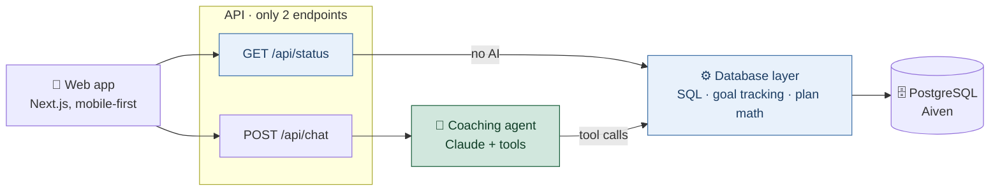

# 🧭 Money Polku — AI Financial Coach
 
**Your money has a past. Let's plan its future.**
 
<table>
  <tr>
    <td width="320" valign="top">
      
    </td>
    <td valign="top">
*Polku* is Finnish for "path". Money Polku turns your bank transactions into a personal savings plan and a coach you can talk to.
 
Built at **Junction 2026** for the **S-Bank (S-Pankki)** challenge by team **Holy Ravioli**.
 
    </td>
  </tr>
</table>

## 💡 The idea

Bank apps show what already happened. People want to know what is coming and what they can do about it. "Can I afford this trip?" or "What do I cut to build an emergency fund?" are hard questions to answer from a list of transactions.

Money Polku answers them from **your own data**. The AI coaches, the code does the math, and you stay in control.

## 📸 Screenshots

Real flows from the app, using customers from the S-Bank dataset.

### 1. Start with a goal that matters to you

The coach asks what you want to save for, looks at your past spending and suggests where to cut. You choose the limits. The goal and plan are saved only after you say "yes".

<table>
  <tr>
    <td align="center" width="50%">
      <br>
      <sub><b>Pick a goal.</b> Four simple starting points, or your own.</sub>
    </td>
    <td align="center" width="50%">
      <br>
      <sub><b>Confirm the plan.</b> Restaurants €250 and Lifestyle €200 per month. The amounts come from past spending, so the coach calls them estimates.</sub>
    </td>
  </tr>
</table>

### 2. See where you stand

The home screen shows the goal, the saved amount and a clear status. 🟢 means on track. 🟡 means the plan needs a small change.

<table>
  <tr>
    <td align="center" width="50%">
      <br>
      <sub>🟢 <b>On track.</b> €3,768.22 of €6,500 saved (58%). The user asks "Can I reach my goal sooner?" and the coach suggests monthly limits.</sub>
    </td>
    <td align="center" width="50%">
      <br>
      <sub>🟡 <b>Needs adjusting.</b> €657.12 of €3,000 saved (22%). The coach gives one small tip and quick questions are one tap away.</sub>
    </td>
  </tr>
</table>

### 3. Change the plan when life changes

Behind on the goal? Tap **Change plan** and talk to the coach. It shows what changes and what stays the same. Nothing is saved until you confirm.

<table>
  <tr>
    <td align="center" width="50%">
      <br>
      <sub><b>Behind plan.</b> €655.34 of €4,000 saved (16%). The Change plan button is right on the card.</sub>
    </td>
    <td align="center" width="50%">
      <br>
      <sub><b>You confirm every change.</b> The user replies "yes" and the new plan is saved.</sub>
    </td>
  </tr>
</table>

## ✨ Key Features

- **Personal** — the plan is built from your own transaction history. The coach finds patterns and asks "Is this you?" before it plans anything.
- **Realistic** — one goal at a time. The coach says if the goal is possible, how much to save each month and where to cut back.
- **Clear progress** — a goal bar with status (🟢 on track, 🟡 needs adjusting), a weekly sprint and a forecast vs. actual chart.
- **Rescue quest, not a ban** — if you go off course, you get one small action. It never asks you to save more than the overspend.
- **You stay in control** — every plan change needs your "yes". Tap **Change plan** or **Explain** anytime.
- **Numbers come from code, not from the model** — goal, progress, warnings and limits are calculated in TypeScript from the database. The model never calculates or invents a number.

## 🛠 Tech Stack

| Layer    | Tools                                                    |
| -------- | -------------------------------------------------------- |
| Frontend | Next.js 16 (App Router), TypeScript (strict), Tailwind CSS, shadcn/ui |
| AI       | Anthropic SDK (Claude) with tool use                     |
| Backend  | Next.js API routes, zod validation                       |
| Database | PostgreSQL on Aiven (`pg` driver)                        |

## 🧠 Architecture



- **Two API routes only.** `/api/status` reads the home screen data with no AI. `/api/chat` talks to the agent.
- **Thin tools.** One agent tool per `Db` method. No SQL and no math in the agent layer.
- **All goal math is plain TypeScript** in `src/lib/db/logic/`, so every number can be traced and tested.

## 📊 Data Findings

We checked the S-Bank dataset (synthetic: 5,100 customers, 3.6M transactions, Oct 2024 – Sep 2026) before building the forecast.

- **Fixed payments are easy to predict.** Housing and salary: about 5% median error using last month.
- **Everyday spending is noisy.** About 31% median error for purchases, so every plan needs a buffer.
- **Seasonality is real by category, not in total.** Travel peaks in July (+28%), Home & Tech in November (+28%), Health in February (+20%). Friday and Saturday spending is about 27% above average.
- **Recent months beat "same as last year"** (31% vs 45% error), so we use seasonal indexes per category.
- **Merchant-based subscription detection does not work** on this data. We use transaction type instead.
- **"People like you" did not beat the user's own history** in our backtest. It helps most when the history is short.

## 📉 Measuring and Optimizing the Agent
 
After the hackathon, I added prompt evaluation (fixed test scenarios with automatic checks)
and used it to measure and optimize the agent's token usage: prompt caching, compact data
formatting, history compaction, and slimmer tool responses.
 
**Results:** input tokens down 58% overall across the evaluation scenarios (up to 77% in some).
In live conversations, creating a goal needed 65% fewer input tokens (cost
$0.269 → $0.139), and a follow-up chat used 73% fewer tokens on repeat questions. All
safety checks (correct tool order, nothing saved without the user's "yes", only real
categories used) held throughout.
## 🗂 Project Structure

<details>
<summary>Show structure</summary>

```
src/app/                 pages and layouts (UI)
src/app/api/status/      GET /api/status
src/app/api/chat/        POST /api/chat
src/components/          UI components (home screen, chat, coach widgets)
src/lib/ai/              Anthropic client, prompts, tools, run loop
src/lib/db/              the only place that talks to PostgreSQL
  logic/goals.ts         pure goal math: progress, savings, warnings
src/types/contracts.ts   shared types between UI, API and db layer
db/migrations/           numbered SQL files
scripts/                 CSV → SQL loader for the S-Bank dataset
docs/                    idea, tasks, specs, screenshots, setup
```

</details>

Want to run it locally? See [`docs/SETUP.md`](docs/SETUP.md).

## 🔭 Roadmap

- **Recurring payments** — detect rent, mortgage, car and loan payments from categories, MCC codes and timing.
- **More goals per person** — today the app focuses on one goal at a time.
- **More banks** — a multi-bank view with PSD2.
- **People like you** — benchmarks from similar customers, with open data from Statistics Finland.
- **Proactive alerts** before a tight month.


## 👥 Team

**Holy Ravioli** — [**Anna**](https://github.com/Nyukaa/) (API, AI agent and tools) · **Alex** (database and goal logic) · [**Elya**](https://github.com/Kopiika) (UI)
